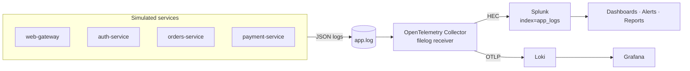

# Splunk Log Analytics with OpenTelemetry


**Find the failing payment provider, the brute-force attacker, or the slow database in minutes, from logs alone.**

A complete log pipeline: services write structured JSON logs, the **OpenTelemetry Collector** ships them to **Splunk** (via HEC) and **Grafana Loki** at the same time, and a Splunk app delivers dashboards, alerts and reports as code. Built-in incident simulation lets you trigger real-looking outages and investigate them.


## Architecture



**Why OpenTelemetry in the middle?** Applications log to a file; the collector decides where logs go. Moving from Splunk to another backend (or running both during a migration) is a config change, not an app change. That vendor neutrality is the main reason teams adopt OTel.

## What's inside

| Part | Details |
|---|---|
| **Log generator** | 4 services emitting realistic JSON logs with a shared `trace_id` per request; switchable incidents |
| **OpenTelemetry Collector** | `filelog` receiver with JSON parsing, timestamp and severity mapping, persistent read position, batching, retries, and two exporters (Splunk HEC + Loki OTLP) |
| **Splunk app (as code)** | Dedicated `app_logs` index with 7-day retention, JSON sourcetype, calculated fields, search macros |
| **Dashboards** | *Service Health* (golden signals, availability, top errors, click-to-trace) and *Security - Authentication* |
| **Alerts** | 5xx rate > 5%, payment provider failures, brute-force logins, p95 latency > 1s, **log pipeline stopped** |
| **Reports** | Top failing endpoints, availability by service |
| **SPL cheatsheet** | 14 commented [SRE searches](docs/SPL-cheatsheet.md): golden signals, tracing, anomaly detection, security, ingestion lag |
| **Grafana + Loki** | The same logs, queried with LogQL |
| **CI** | Validates the Splunk app, collector config, YAML/JSON, generator unit tests, ShellCheck, gitleaks |

## Quick start

Requirements: Docker with Compose v2 and **at least 6 GB of RAM** for Docker (Splunk is heavy).

```bash
git clone https://github.com/ragulmk/splunk-otel-logs.git
cd splunk-otel-logs
make up            # creates .env with a random password + HEC token, starts everything
```

Wait 2-3 minutes for Splunk to start (`make ps` shows `healthy`), then open:

- **Splunk:** http://localhost:8000, user `admin`, password from `.env`. Open the **Observability - App Logs** app.
- **Grafana:** http://localhost:3000, dashboard *App Logs (Loki via OpenTelemetry)*.

Check each stage of the pipeline with `make status`.

## Demo: simulate an incident and investigate it

```bash
make incident-payment      # razorpay starts timing out for 10 minutes
```

1. On **Service Health**, the *Payment failures* counter and *5xx* traffic turn red.
2. *Top errors* shows `upstream timeout after 5000ms` from `payment-service`. Click the row and the *Trace* panel shows that request's log lines from the gateway and the payment service.
3. Within 5 minutes, *Payment provider failures* appears under **Activity > Triggered Alerts**, naming `razorpay`.
4. Run the *Revenue lost to failed payments* search from the cheatsheet to put an INR figure on the incident.

Other scenarios:

```bash
make incident-bruteforce   # two IPs hammer /api/login: see the Security dashboard and brute-force alert
make incident-slowdb       # orders-service latency climbs: p95 panel and slow-response alert
make incident-stop
```

## Repository layout

```
├── loggen/                       log generator + unit tests
├── otel/config.yaml              OpenTelemetry Collector pipeline
├── splunk/app_observability/     Splunk app (mounted into the container)
│   ├── default/indexes.conf      app_logs index and retention
│   ├── default/props.conf        JSON extraction and calculated fields
│   ├── default/macros.conf       `app_logs`, `gateway`
│   ├── default/savedsearches.conf  alerts and reports
│   └── default/data/ui/views/    dashboards (Simple XML)
├── grafana/  loki/               Loki backend and dashboard
├── docs/SPL-cheatsheet.md
└── scripts/                      setup, incidents, HEC test, validation
```

## Notes

- **License:** a new Splunk container runs a 60-day Enterprise trial with everything enabled. After it converts to Splunk Free, scheduled alerts stop running; dashboards and searches still work.
- **Apple Silicon:** Splunk only publishes `linux/amd64` images, so it runs under emulation (slower startup).
- **Secrets:** `.env` holds the password and HEC token and is git-ignored. CI runs gitleaks to catch accidental commits.
- **Troubleshooting:** if Splunk shows no data, run `make logs` to see collector errors, and `./scripts/send-test-event.sh` to test HEC directly.
- **Production:** use a valid TLS certificate on HEC instead of `insecure_skip_verify`, and send alerts to Slack or PagerDuty with the corresponding Splunk add-on.

---

**Need Splunk dashboards, alerts or an OpenTelemetry log pipeline for your team?** I build these as fixed-price projects. Contact me on [LinkedIn](https://www.linkedin.com/in/ragulmanikandan/).

License: MIT
